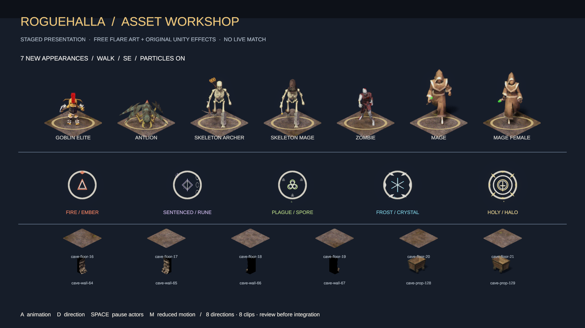

# Asset inventory and Unity workshop verification

Source revision: `bff5e014` on `codex/unity-asset-readiness`, based on coordinator-approved `70579162ce41a1325aaed1a65a34b65b779ad1e7`. The code, imported catalog and derived textures tested and captured have their exact SHA256 values in [verification.json](verification.json). The evidence commit follows the source commit; no runtime code changed between capture and source commit.

This is **asset preparation and Editor preview evidence**. It does not integrate the new sprites or particles into live matches, replace the accepted protocol13 Web artifact, prove full original-game visual parity, or establish the 144 FPS target.

## Original-game inventory

The [inventory](../README.md) covers 125 presentation cues/families and indexes all 176 visual source modules, 57 cosmetics, 80 card IDs, 20 quests/givers and 26 achievements. Source references and module hashes are included. Original client media scanning found no checked-in image, sound, music or font binaries; the source creates artwork through Phaser graphics, generated textures/SVG, DOM and CSS. Unity's audio is an added presentation layer, currently a limited eight-clip set.

All inventory JSON parses, source paths exist, indexed module hashes match, and local documentation references resolve. Actual Unity implementation is separate from the older readiness-contract classification: `available` facts do not imply rendered or finished art. Protocol13 Wish corrections preserve accepted all-five-Wish/Trophy proof, without claiming that blocked/refusal feedback or barrier browser cases were proved.

## Prepared and imported in this batch

- Five additional Flare creatures: elite goblin, antlion, skeleton archer, skeleton mage and zombie.
- Two mage/staff appearances, composed from matching male/female body, head and garment layers.
- 1,896 nonempty animation sprites, covering eight common actions in all eight directions.
- Twelve cave samples: six floors, four wall/structure faces and two props, using official source rectangles and pivots.
- Five original Unity particle studies with distinct persistent faction glyphs/rings. Each particle system is capped at 32; the total configured cap in this workshop is 160.

All 36 newly copied source files match their recorded size, SHA256 and Git blob SHA-1. Pinned Flare source, $0 public-download prices, captured Credits revision, license, import boundaries and limitations are in [ASSET_EXPANSION.md](../../ASSET_EXPANSION.md) and the retained source manifest. Source images and definitions are unchanged. Derived Flare sheets/crops retain the applicable CC-BY-SA attribution/share-alike terms.

The catalog is outside `Resources`, at `Assets/Art/Derived/FlareExpansion/AssetReadiness.asset`. No live scene, Bootstrap, ArenaView, MatchHud, networking, game rules or protocol files were changed. Future builds do not automatically acquire these preview textures through a Resources catalog.

## Checks and observations

| Check | Result |
|---|---|
| Unity Editor compilation | Passed in existing Unity 6000.0.85f2 Editor, URP 17.0.4, active WebGL target; [receipt](compile.json) |
| Existing C# network suite | 399 passed, 0 failed, using local .NET 8 SDK |
| Unity source-copy check | Passed; network source/copy files are unchanged |
| Existing Unity EditMode suite | 62 passed, 0 failed/skipped; [receipt](editmode.json) |
| Catalog and frame resolver | Seven appearances, 1,896 sprites, 896 action/direction/first-and-late-time checks; [receipt](validation.json) |
| Independent PNG alpha audit | All 1,896 actor cells contain art and have positive edge clearance; [audit](alpha-audit.json) |
| Reduced motion | Five systems cleared to zero particles; ten persistent ring/glyph identifiers remain enabled |
| Isolated preview | No MatchClient exists; no match session or gameplay simulation is created |
| Actual advancing play | Frame count 50 → 52; [receipt](advancing-frames.json). Normal-mode particle count was 30 at validation |
| Console | Zero errors/warnings during preview and after stopping; [preview](preview-console.json), [stopped](stopped-console.json) |
| Scoped code/docs whitespace check | Passed. Upstream source bytes and Unity-generated metadata preserve their original/generated whitespace |
| Accepted protocol13 archive | All 14 files / 74,247,550 bytes still match the accepted manifest hashes |

The alpha audit caught three antlion action frames touching an atlas edge. A four-pixel anchor adjustment preserved ground contact and authored pixels while leaving three pixels of left and four of right clearance. The importer was rerun and the final atlas rechecked. An initial tile-row inversion and a Unity 6 single-sprite pivot API mismatch were corrected before the accepted import/captures.

Sampled fully covered faction-label pixels in the actual render contrast against the flat workshop background at 6.06:1 (Fire), 8.84:1 (Sentenced), 9.48:1 (Plague), 8.74:1 (Frost), and 10.94:1 (Holy). These are bounded screenshot samples, not a claim of full-game accessibility conformance. Persistent identifiers also differ by shape.

## Actual Unity renders

These PNGs come from Unity Pipeline `capture game_view`, `source=camera`, with overlay UI, at 2560 × 1440. They are actual Editor camera renders. They are not AI illustrations, native 144 Hz display captures, browser proof, or measured 1440p performance results. Displayed actor and sample sizes are chosen for inspection and do not establish live obstacle footprints/world scale.

[Reduced-motion capture](workshop-reduced-motion.png) shows the persistent faction shapes after clearing particles and selecting still animation frames.

To inspect in Unity: **Roguehalla → Art → Play Asset Readiness Workshop**, then focus the Game view. **A** cycles eight actions, **D** cycles eight directions, **Space** pauses actors, and **M** toggles reduced motion. Reimport is available at **Roguehalla → Art → Import Flare Expansion**. The workshop starts through the existing no-network presentation bootstrap and replaces only that staged study.

The unfocused Editor initially stopped at frame 2; its screenshot was not accepted as animation proof. The final verification enabled background play temporarily, confirmed advancing frames, then captured. Play mode was stopped, background play restored to false, auto-tick disabled, and the Editor's whitespace-only ShaderGraphSettings serialization rewrite restored to the original bytes.

## Still incomplete

The [complete checklist](../asset-checklist.json) remains the work queue. Main gaps are faction silhouette/cosmetic coverage, role and elite glyphs, complete creature/biome/landmark/prop coverage, polished combat/Wish shapes and sound variety, the original hub and broader HUD/menu/map/quest/trade/training surfaces, missing authoritative presentation facts, and approved live binding. New Web build/browser/visibility proof and fixed-High 1440p/144Hz performance measurements are required after integration; none is substituted by this preview.
