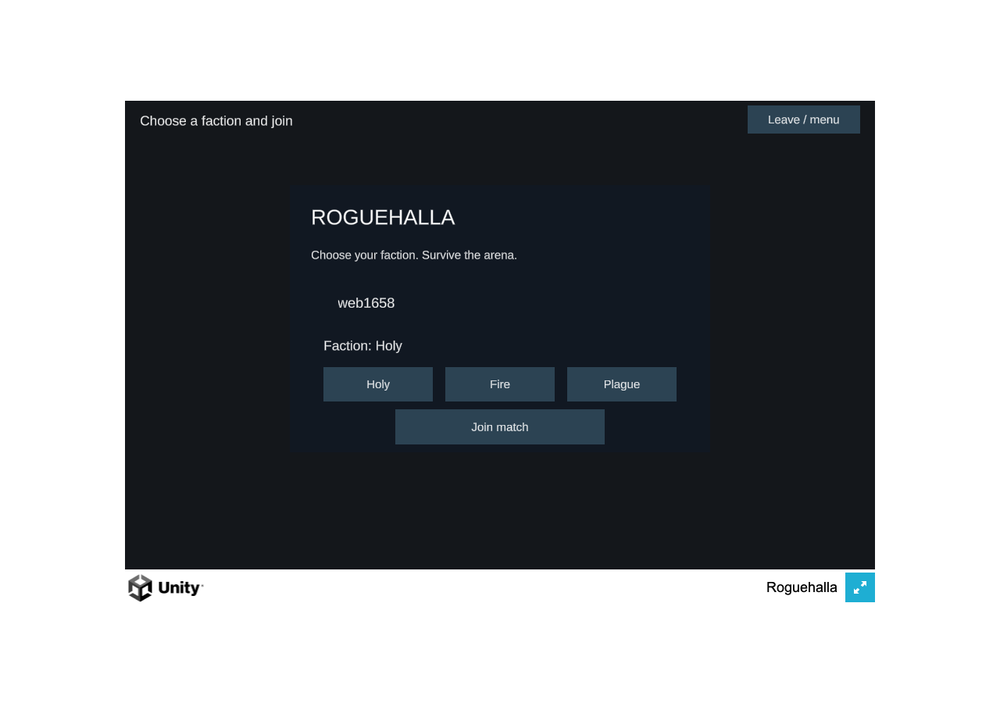
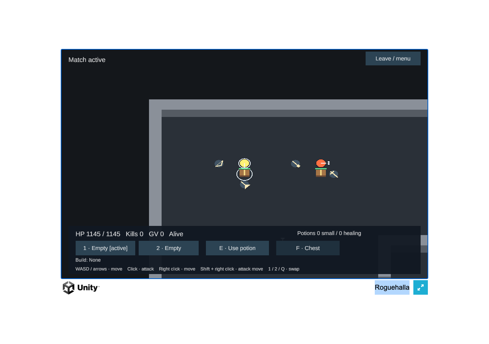
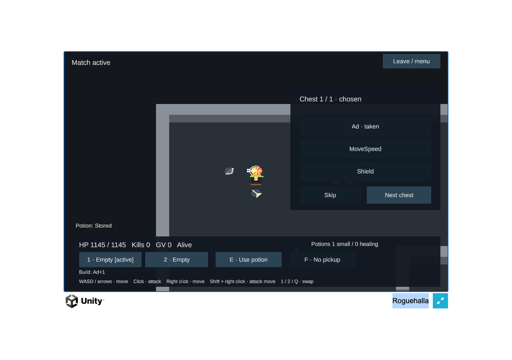
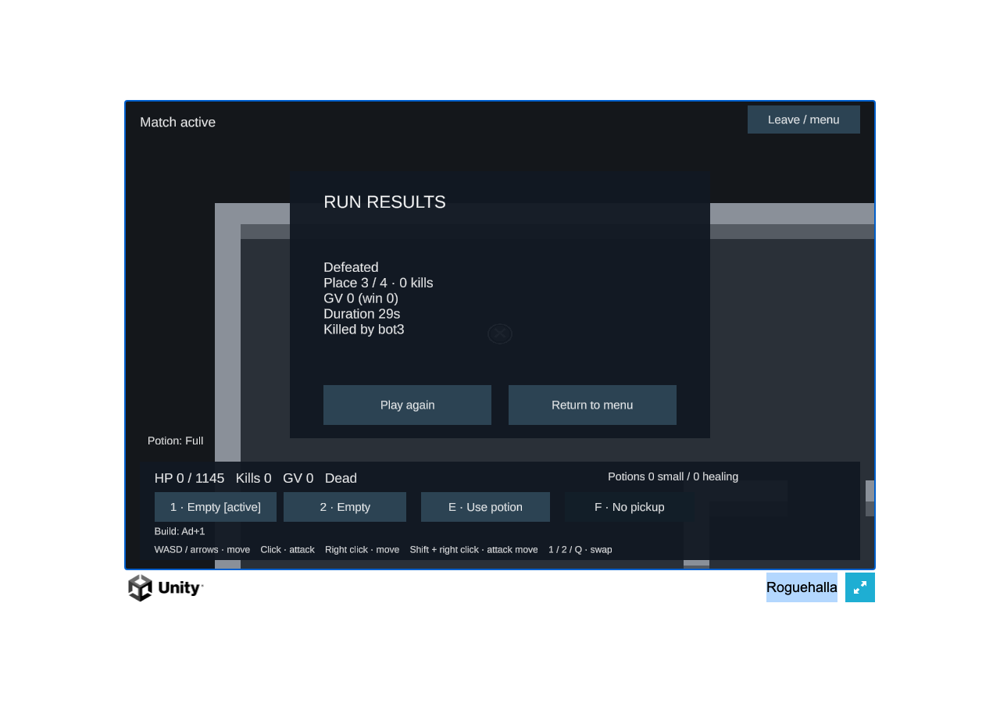

# First playable on the Calgary practice domain

The actual Unity Web player completed the MVP loop at **https://rougehalla.com/** against the Rust server in
**ca-west-1a (Calgary)** on2026-11-06. This is the temporary single-host exception in
[ADR0020](../../adr/0020-temporary-single-host-staging.md), not managed GameLift, durable progression, scale proof or
production rollout. All implementation remains on `optimization_port`; `play.roguehalla.com` was not changed.

**The bounded playtest has ended and its practice deployment is removed.** [Cleanup](cleanup.json) passes at
2026-11-06 13:03:33UTC /06:03:33 Edmonton. This page retains historical deployment evidence.

## Actual public browser proof

A bare HTTPS visit uses the packaged same-origin WSS default and waits at the menu. Chromium then drives the actual
Unity HUD/keyboard/mouse: nickname/faction, exact map and all seven collections, loot/potion feedback, a real chest
choice and server-confirmed build change, combat, visible mobs, movement, swap, results, reconnect and fresh rejoin.
Every functional check passes; page/observer/decoder errors are zero. No private simulation inputs, synthetic outcomes
or separate game socket are used. A separate in-app browser also displays the live menu. Rust foundation/C# CI at `484cef25726d8ad203468ea0df47d62bb9fdb6b5`
[passes](https://github.com/Nevanyte/RougeHalla/actions/runs/42190950142), as does
[hosting validation](https://github.com/Nevanyte/RougeHalla/actions/runs/42190950113).

[Browser proof](browser-proof.json) · [TLS/DNS proof](public-tls.json) · [response headers](web-headers.json).
Both authoritative Cloudflare nameservers return the owned A record at TTL60. The public certificate validates normally
for rougehalla.com (Let's Encrypt YE1); no self-signed bypass is enabled. Wasm serves as `application/wasm`; Wasm and JS
negotiate gzip with `Vary: Accept-Encoding`. The `.data` response is not gzip-compressed in this temporary configuration;
further download optimization remains open. Browser load success is a functional check, not a performance comparison.

## Exact artifacts and bounded operation

Native source files match first-playable commit `484cef25726d8ad203468ea0df47d62bb9fdb6b5` (555 files checked).
The Linux arm64 executable identifies its frozen build as `b6a79ad-mvp-workingtree`; that label alone is not its source
identity. [Linux build](linux-build.json) and the retained private source manifest identify the measured/deployed bytes.
The copied Web payload is unchanged except its HTML same-origin configuration; [packaging hashes](web-packaging.json)
record that wrapper separately from the original M5 Pro benchmark artifact. Notices accompany the player and Caddy.
[Caddy provenance](caddy-provenance.json) retains official release digests.

One t4g.small/2GiB host uses standard CPU credits, IMDSv2, no instance role or SSH, encrypted8GiB gp3 with deletion on
termination, and only public80/443. The actual console confirms the expiry timer and egress limiter before public
serving. API checks confirm the instance/disk settings in [runtime guards](runtime-guards.json).
[Preparation checks](preparation.json) cover lint, guard, schema, shell and actual Linux Caddy validation.
The preparation hash inventory is a historical prelaunch baseline; its current-helper hashes and the later ownership
probes separately record the subsequent script repair. Template/bootstrap bytes were unchanged.
AWS leaves a pending CREATE stack untagged; its reviewed matching change-set tags now prove pending ownership, while
created stacks still require their own tag. [Failure probes](ownership-probes.json) retain the refusal controls.

The original authorization remains **CAD20 total**; this run reserves CAD10 including margin and does not expand the
limit because credits exist. Fixed expiry is **2026-11-06 13:34:12UTC**. Cleanup is assigned for **13:00UTC /06:00Edmonton**,
before the Rust admission cutoff and host fallback. The operator removes only the marked practice DNS record, lets its
TTL expire, then deletes the exact owned stack/bucket and verifies volume/IP cleanup. **Cleanup is now verified.**
The exact marked DNS record disappeared by13:00:31UTC; AWS deletion began13:01:44UTC after the full60s window.
Independent checks completed13:03:33UTC: instance terminated with no public IP/block devices; root volume, stack,
artifact bucket and VPC absent; no owned ENIs/address allocation. Both authoritative Cloudflare nameservers return
no A/AAAA/CNAME for the practice apex. The coordinator verified all four private cleanup evidence digests and
published the [sanitized result](cleanup.json). Production remained untouched.
The release object was deleted after successful bootstrap, revoking the presigned download; no permanent key or instance
IAM role was installed. The empty artifact bucket is included in cleanup.

[Budget reservation](budget-reservation.json) uses conservative compute/disk/IP arithmetic plus a bounded8Mbit/s public
transfer rate; credits are not used to enlarge the budget. Cost Explorer is disabled, so this record does not certify a
zero posted bill. The account plan was not upgraded. In-memory profiles/results are disposable and are not production
accounts or persistent progression. The full browser matrix, matched legacy performance and broader port remain open.

