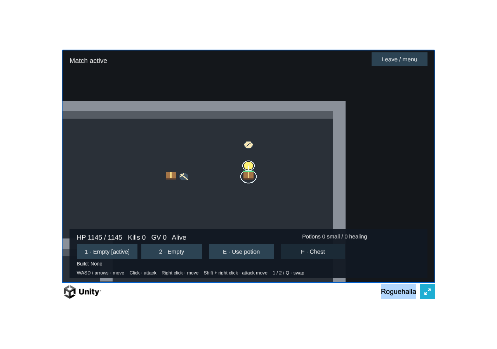

# Live-domain performance on the M5 Pro

Measured **https://rougehalla.com/** on2026-11-06, using the actual Unity Web player and Calgary Rust server.
The main sample is24.409s of active/alive gameplay at960×600/DPR1 in visible, focused Chromium156 on native M5 Pro Metal.
It submits1,464 rendered frames with ordinary browser pacing. The same build/settings remain deployed; profiling
changed no game code, quality, player settings, host configuration or budget limit.

## Normal play

| Metric | Median | p95 | p99 / maximum |
|---|---:|---:|---:|
| Rendered frame interval |16.70ms|18.50ms|18.60ms p99;18.80ms max|
| Synchronous callback CPU |1.60ms|2.20ms|2.50ms p99;3.80ms max|
| GPU elapsed work |0.20275ms|0.215999ms|0.241375ms p99;0.483583ms max|
| Actual Unity socket Ping/Pong RTT |9.90ms|11.00ms|11.70ms p99/max|
| Snapshot delivery interval |50.00ms|51.80ms|53.40ms p99;56.70ms max|

Average observed rendering rate: **59.98FPS**. No frame exceeds33.3ms. Every observed snapshot tick advances by one;
488 snapshots arrive at19.993/s, with no delivery gap above100ms. The game remains authoritative at20Hz. The RTT uses
24 actual Unity-generated Ping/Pong pairs, from socket send to browser message delivery; later Unity frame polling is
outside that timer. Snapshot delivery is separate from server simulation cost. No packet-loss percentage was measured.

All1,464 GPU observations are available, with zero disjoint events. Five GL draws are observed per rendered callback.
CPU callback time excludes asynchronous renderer work and is not complete Unity/OS CPU cost. CDP main-task counters
advance2.903s across the enclosing capture (approximately11.9% of its wall time); their endpoints slightly bracket the
active-only cutoff. This is task duration rather than an OS CPU-utilization measurement. Instrumentation adds cost.
Memory channels are **23.53–25.19MiB JS heap** and a stable **66.50MiB Wasm linear allocation**. They are separate from
total browser RSS, C# allocation/GC and GPU memory, which were not measured here.

The actual encounter delivers two remote actors including one mob,0–1 projectile,58 swings and58 hits. One ordinary
canvas attack is followed by observation; the sample stops at authoritative death/end. This is a small MVP encounter.
Full eight-player density, other browsers/resolutions, long thermal runs and production capacity remain unmeasured.

## Network and loading

A separate60-request warm HTTP `/ping` sample on the same game-process path measures **10.675ms median,12.211ms p95,
13.285ms p99/max**, minimum9.039ms. All requests reuse one TLS socket and return the uncached four-byte pong. Three
fresh-connection totals are66.721/38.575/40.217ms; their TCP phases are about10.9–11.0ms and TLS phases15.5–16.6ms.
Cold lookup timing includes local OS/request setup and cached resolution; no DNS caches were flushed. These probes
complete before the successful browser load and do not contend with it. Source is this Mac’s Wi-Fi connection to Calgary.

Active application traffic averages **770.25B/s down /372.65B/s up**, excluding WebSocket/TLS/TCP/IP overhead. The
8Mbit/s staging transfer cap leaves ample room for this single client’s gameplay traffic. Long-run congestion and
multi-client capacity are separate tests.

The fresh browser has HTTP caching disabled and validates public TLS normally. Four Build resources transfer
**23,504,777B (23.50MB)**, decoded55,817,288B. Payload response-end is24.281s; Unity-ready is24.512s. The24.5s load is
consistent with the deliberate8Mbit/s staging cap (about1MB/s). The menu remains offline until Join. The harness then
waits5s and enters its nickname; that automation wait is not loading. Join-to-Welcome is146.9ms and Join-to-active3.202s,
including normal server lobby/fill time.

| Build payload | Encoded transfer | Decoded bytes | Encoding |
|---|---:|---:|---|
| Wasm |12,595,926B|44,548,477B|gzip|
| Data |10,809,404B|10,809,404B|uncompressed|
| Framework JS |90,027B|432,952B|gzip|
| Loader JS |9,420B|26,455B|gzip|

The initial `.data` asset accounts for10.81MB of that transfer. Further loading optimization remains available. Resource
Timing contains complete encoded/decoded counts. Optional CDP extraction of the Wasm response body was evicted from
its inspector cache, so that optional response hash is unavailable; this collection warning is retained in the report.
There are no game, page or protocol-decoder errors. No service worker is active.

## Actual Calgary server cost

The new completed room is uniquely identified by comparing public `/info` before/after: one additional676-tick room,
with earlier reports unchanged. Its game-step timing is **63µs median /159µs p99 /578µs maximum**. This timer includes
bot decisions, lease expiry and `Sim::step_into`, and ends before recorder hashing, policy feed, projection/publish,
serialization or socket writes. It covers the whole room’s lobby/active/ended ticks. p50/p99 are conservative log-histogram
bucket bounds (up to25% above the exact integer-microsecond quantile); maximum is exact to the timer’s microsecond unit.
The p99 value uses0.318% of the50ms tick budget for that measured scope, with no sustainable-capacity extrapolation.

No dropped steps, late wakes, frame/snapshot refusals, skipped snapshots or room crash are reported. The room emits
581 delta snapshots and one full snapshot; application output is23,599B over its lifetime.
The host is a2vCPU/2GiB t4g.small. Default EC2 monitoring supplies coarse host CPU/network data; the retained CloudWatch
query **predates this successful browser window**, so it is historical context only. Server RSS, a live active-only
simulation histogram and projection/publish latency are unavailable through the current public deployment.

## One separate uncapped diagnostic

With the same build, quality,960×600 canvas and native Metal, one8.0847s run adds only
`--disable-frame-rate-limit --disable-gpu-vsync`. It records **6,108 GL-submitting callbacks /755.50 callbacks per second**.
This describes experimental submission headroom; presented/displayed FPS and sustainable shipping FPS are unmeasured.
The different random encounter has5–6 visible remote actors, three mobs,0–4 projectiles and59 swings/62 hits, so it is not
a paired normal-versus-uncapped workload.

The diagnostic’s synchronous callback CPU p50/p95/p99 is0.20/2.60/2.60ms (mean1.213ms). CDP main-task time is8.046s over
8.0847s of enclosing capture, occupying nearly all of that browser main thread’s task time. GPU queries cover only184/6,108 callbacks (3.01%); that distribution cannot
be compared with the complete normal sample. No additional run or quality downgrade followed. The owner’s objective
remains the highest sustainable frame rate; current normal browser pacing is an observation rather than a performance goal.

[Metric summary](metrics.json) · [normal report](browser-normal.json) · [uncapped diagnostic](browser-uncapped-diagnostic.json) ·
[HTTP timings](http-ping.json) · [completed-room report](server-after.json) · [historical EC2 monitoring](cloudwatch-before.json) ·
[hash manifest](manifest.json). Raw frame/query records and the private collector are retained locally by hash.

