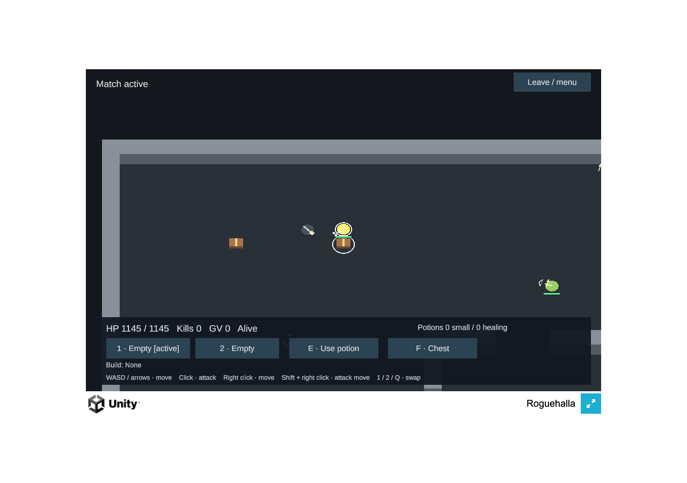

# First playable M5 Pro runtime baseline

These bounded measurements describe the selected MVP. They do not establish full-game legacy speedup, sustainable
multi-match capacity, other hardware, or a browser matrix. The owner’s objective remains the highest sustainable
frame rate;60FPS is not a target. No quality reduction or player setting change was made for these measurements.

## Native Rust

Apple M5 Pro,18 logical CPUs,64GiB RAM, macOS26.6.1; Rust1.97 arm64 release, opt3/debug1, no LTO or custom RUSTFLAGS,
default production features. Three trials per scope use the ordinary six-seat public-policy run on the selected map.
Each advances687 times from initial tick1 to normal terminal tick688; all reproduce `8ed7fd3004c689d5` without faults.

| Scope | Mean per tick across trials | p99 across trials | Whole loop wall time |
|---|---:|---:|---:|
| Shared Env policy/observation/submit/step loop |19.867–23.808µs|64.666–77.834µs|13.663–16.373ms|
| Sim::step_into only |11.344–12.698µs|28.000–32.834µs|7.824–8.754ms|

The Sim timer excludes input replay/submission; whole-loop wall time includes it. Env uses `advance`, not the owned
`StepOut` clone of `try_step`. Construction, report JSON, checkpoints, hashing and file I/O are outside timed regions.
Allocation/RSS were not measured by this benchmark; separate steady allocation tests have their own scope. These are
short serial trials, not a thermal soak or a server-throughput guarantee. The authoritative game remains fixed20Hz.

[Native results](native.json) · [build/source identity](native-build.json) · [measured benchmark source](native-bench.rs).
The [frozen source manifest](source-manifest.json) identifies the measured dirty working tree derived from base `b6a79ad`;
that base revision alone is not the measured source identity. The retained private standalone harness freezes388 source files and avoids example dev-feature unification; a future
portable checked-in benchmark should extract the existing public proof wrapper rather than introduce new game AI.

## Actual Unity browser

Headed Chromium156, native `ANGLE Metal Renderer: Apple M5 Pro`,1280×900 viewport,960×600 canvas/backbuffer, DPR1,
visible/focused. After2s active/alive warmup, all480 rendered observations in an8s normal-pacing window are eligible.
Actual delivered other actors2–3, including1–2NPCs, and projectile rows0–3. The window receives25hits/14swings/1death
from normal bot/NPC combat; the idle human remains alive. No scripted player actions or extra game socket are used.

| Measurement | p50 | p99 |
|---|---:|---:|
| Rendered animation-frame interval |16.70ms|18.60ms|
| Synchronous callback CPU envelope |1.70ms|2.70ms|
| GPU timer query,479 samples |0.2056ms|0.2207ms|

Zero observer/page errors and GPU-disjoint events. Five observed GL draws per callback. JS heap24.1–26.7MB and Wasm
linear memory69,730,304B; these are not total process RAM/VRAM. Synchronous callback duration is not full PlayerLoop
or total browser CPU. Its much shorter CPU/GPU work is consistent with the observed browser/display pacing.

One separate experimental run requests `--disable-frame-rate-limit --disable-gpu-vsync`:6,020 rendered callbacks in8s,
interval p50/p990.70/2.70ms and CPU0.30/2.70ms. It uses a different random room and has only168 GPU-query samples;
CDP main-task time is7.957s/8s. This is a diagnostic callback rate, **not supported shipping FPS**, equivalent GPU work
or Rust throughput. No third run or quality downgrade followed.

[Normal report](browser-normal.json) · [experimental report](browser-uncapped-diagnostic.json) ·
[exact Web artifacts](web-artifacts.json) · [original evidence manifest](browser-manifest.json).
Both runs and post-run verification have identical per-file artifact hashes. Raw per-frame observations, load timing,
source/settings hashes and harnesses remain in the frozen local evidence; no private socket credentials were captured.

## Loading and remaining work

The measured uncompressed Web tree is55,836,754B, of which Build payloads are55,817,288B; this is198B above Unity’s
aggregate build summary, so exact per-file manifests take precedence. Wasm44,548,477B; data10,809,404B. Normal local
payload response-end125.5ms, first Welcome2705ms, first snapshot2757ms and first active/alive5756ms include different
stages and the normal lobby. These are localhost measurements, not WAN/AWS loading claims. Compressed release hosting
and correct MIME/Content-Encoding headers remain staging work.

The final matched Rust+Unity versus TypeScript+Colyseus+Phaser comparison remains P-LOAD-3. Selected content, visual
differences, actor counts, maps, actions, resolution and browser settings must be matched before reporting a speedup.

