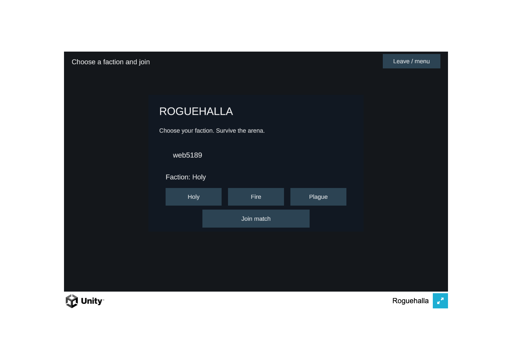
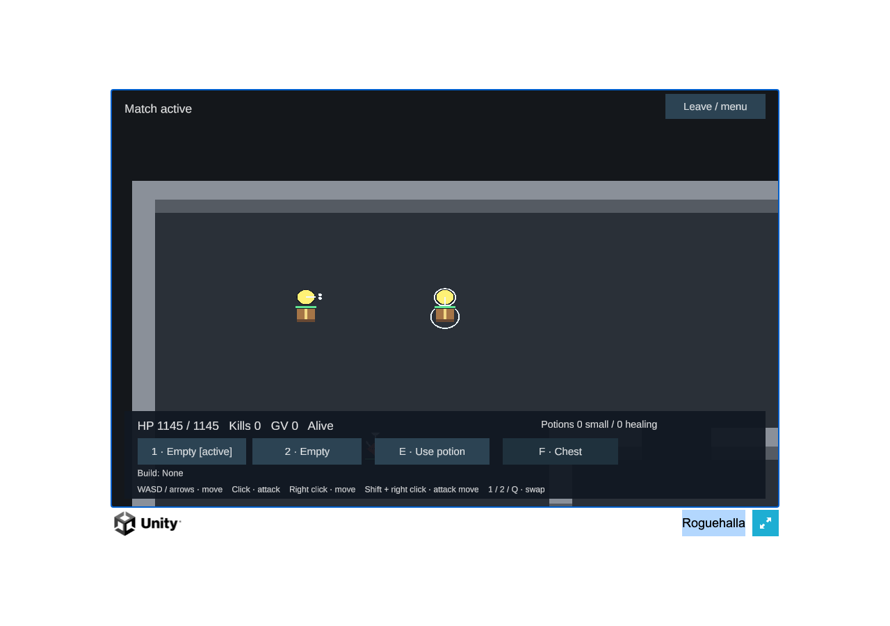
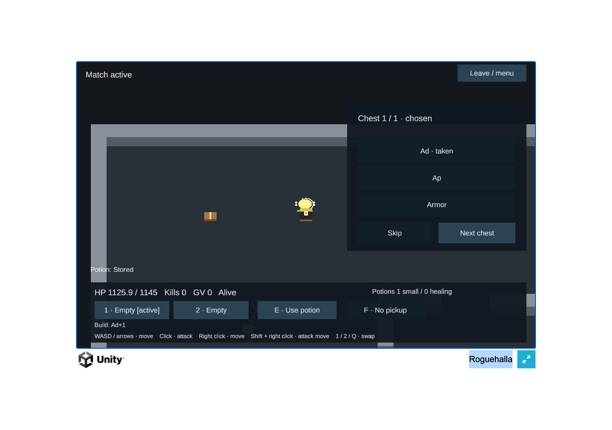
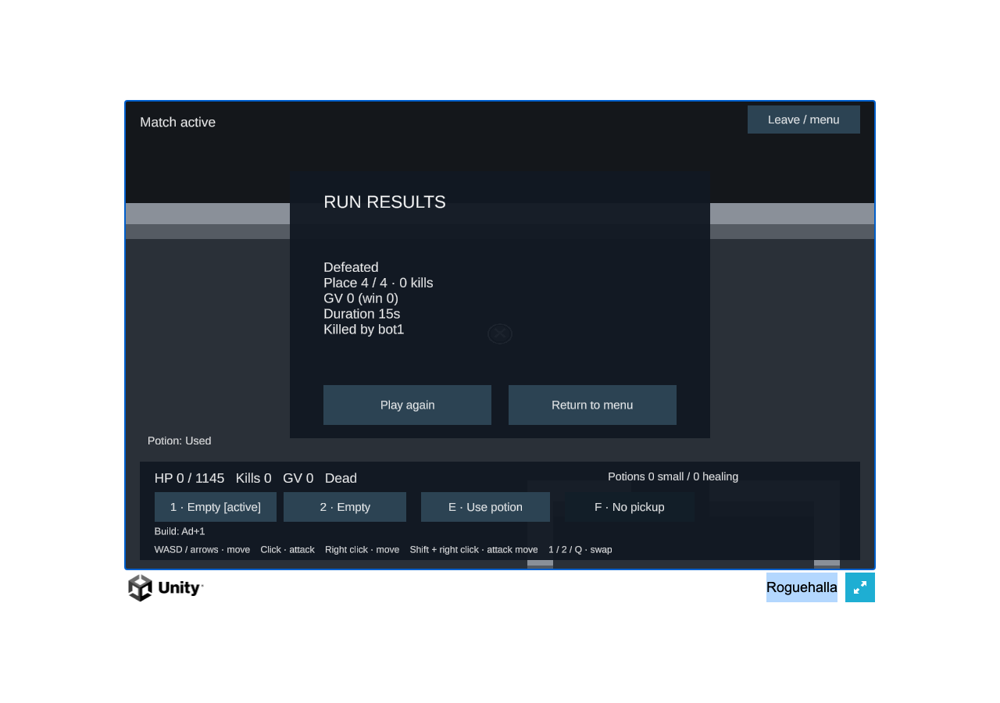

# First playable Unity browser

Unity6000.0.85f2 compiled the actual IL2CPP/WebGL player, and Chromium156 ran it against the real Rust
`--first-playable` server. The final run passes every functional check with zero page/decoder errors:

- Menu waits for a user join; nickname and Holy selection reach the actual Hello.
- The exact48×40 collision grid and all seven reliable state collections arrive. The wire grid identity is
  `1c772b5b`; the full typed map identity is separately `0252d18b`.
- F picks up actual loot, E receives authoritative potion feedback, slots swap and WASD changes the server position
  with an acknowledged order. Clicking the HUD does not attack or move through it; a world click sends attack/release.
- A real issued chest offers AD/AP/armor. Clicking option0 sends Choose with its actual handle; the server changes
  AD boost0→1 and the HUD shows the taken choice/build change.
- Visible mobs render, the player receives a normal server result, a dropped socket resumes the same seat, and
  explicit leave permits a fresh join after results.

[Final browser proof](browser-proof.json) · [independent review](REVIEW.md) · [M5 Pro measurements](../first-playable-performance/README.md).
This is an actual Unity client proof, distinct from the earlier JavaScript WSS transport proof. Input automation uses
the rendered uGUI and normal keyboard/mouse; it does not inject simulation outcomes or send its own game commands.

The client displays delivered positions, HP, weapons, statuses, props, rewards, build and projectile facts. It contains
no physics, collision, combat, AI, potion/loot eligibility or movement prediction. Current NPC/projectile presentation
is20Hz; stable NPC/flight identities and visual polish remain deferred. Reused mesh batches avoid per-reference object
creation. Text uses the imported TMP essentials and bundled Liberation Sans, with source notices preserved.

The review caught a Target+Attack wand click that cancelled its own lock and stale inventory labels after Welcome.
Both are repaired. Actual browser testing also caught Leave being omitted after MatchEnded; the library now sends it
once, with a regression test. Same-frame manual press/release is forwarded. All267 C# tests pass, and Unity copies match.

The checked-in proof is `client-unity/UnityProject/Tools/playable-web.cjs`. Initial attempts are retained privately:
the first acted during the Unity splash, and the next exposed the rejoin bug. The final run fixes those issues rather
than hiding failed evidence. Runtime support is currently proven in Chromium; a full browser matrix remains open.
AWS/TLS/DNS and compressed hosting remain release work. No production or cloud resource was changed.

