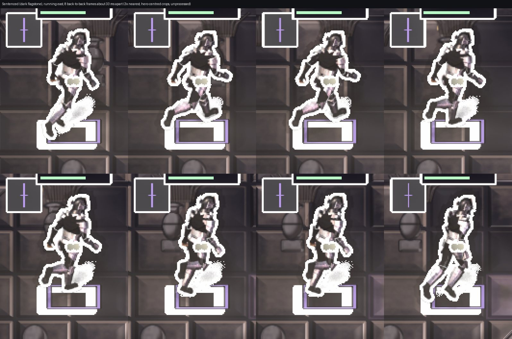
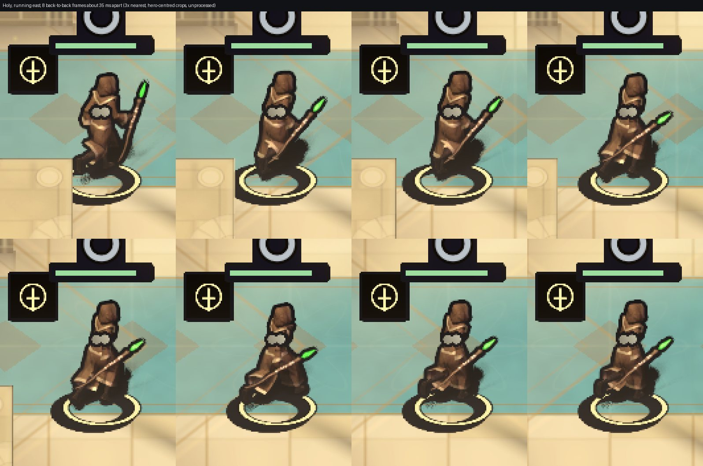

# Character contrast: evidence (branch `rework/contrast`)

## Current state, 2026-11-10: no line outline by default (owner decision), three-way comparison

Owner: "I would prefer just to do no line outline at all at the risk of losing character/background contrast." The baked ground shadow is also gone from every actor sprite and our own contact and cast shadows ground the figure
(see [../../CONTRAST_GATE.md](../../CONTRAST_GATE.md), top section). Everything below this section describes the previous adaptive 3 px outline and is historical; `CONTRAST.md`, `contrast.json` and `worst-after.jpg` in this folder are now the
**no-outline** run (1920x1080, High, 931 cells, exit 1).

| variant (page flag) | EDGE p10 >= 3.0 | markers >= 4.5 | what it costs / how it looks |
|---|---:|---:|---|
| none (default) | 62 / 931 | 1 / 931 | cleanest picture; figures on dark ground (Sentenced, Fire, Plague) have BODY medians 1.4 to 1.5 against the ground, readable by shape and light but not by contrast |
| outline (`?fx.outline=1`, 1 px, softened, adaptive tone) | 428 / 931 | 8 / 931 | helps on dark and mid ground (Sentenced 79 / 90, Plague 160 / 212, Fire 128 / 242), nothing on bright snow and temple (Frost 41, Holy 11); a visible white line, doubled on the foot marker, white frames on plates |
| rim (`?fx.rim=1`, nothing outside the sprite) | 251 / 931 | 0 / 931 | helps on dark ground, least visible, never adds a shape outside the figure; on bright ground it adds almost nothing |

Captures (JPEG, a real bot match at 1080p High, hero running; 3x nearest filmstrips of 8 frames): [dark none](filmstrip-dark-none.jpg), [dark outline](filmstrip-dark-outline.jpg), [dark rim](filmstrip-dark-rim.jpg),
[bright none](filmstrip-bright-none.jpg), [bright outline](filmstrip-bright-outline.jpg), [bright rim](filmstrip-bright-rim.jpg). One frame per zone, none | outline | rim side by side: [Sentenced](compare-sentenced.jpg), [Holy](compare-holy.jpg),
[Frost](compare-frost.jpg), [Fire](compare-fire.jpg), [Plague](compare-plague.jpg). Default in-match frames: `match-*.jpg`. Worst cells of the no-outline run: [worst-after.jpg](worst-after.jpg).
Caveat: the lab measures the silhouette contour as drawn, so the rim (inside the sprite) is measured as the figure's own edge; the strict numbers are comparable but a pass was never expected.

---


Owner requirement ([UNITY_REWORK_FABLE.md](../../../prompts/UNITY_REWORK_FABLE.md) section 4, "Character contrast is a hard gate"): an objective 3:1 between every character and the ground, landscape vivid, faction-coloured outlines **not** used.
Design and definitions: [CONTRAST_GATE.md](../../CONTRAST_GATE.md) ("Branch `rework/contrast`"). Everything here was measured on the real WebGL build in headed Chromium on `ANGLE (Apple, ANGLE Metal Renderer: Apple M5 Pro)`,
on the merged tree (`feature/unity-rework` at `260efe8d`, render pass and audio included). Raw captures stay outside the repository.

## Verdict

**The gate does not pass (exit code 1).** The strict EDGE statistic (p10 of 16 contour sectors >= 3.0) is untouched; it went from **0 of 2,808 cells** (baseline) to **3,339 of 3,724 cells** on the full matrix (1920x1080 and 2560x1440, High and Ultra,
every zone, every surface, every look, idle and walking, two facings, plus the new boundary, seam and prop cells). On **plain ground, 2,384 of 2,472 cells pass (96.4%)**; every surface of Sentenced, Frost, Holy light and the Coliseum passes in every configuration, and so do Fire basalt and lava and Plague mud.
The 88 plain-ground failures are Fire ember (68 of 208), Plague bog (11 of 208), Plague shallow water (8 of 184) and one Holy sand cell. Markers (hp bar, footprint, insignia all >= 4.5): 3,204 of 3,724 cells.
The 24 lowest cells of the whole matrix are all figures that stand behind a bush or palm that is drawn over their lower body, or on a surface boundary (see "What still fails").

| | before (committed baseline `d6f18dce`) | before (re-run on this branch's base, 3 zones, 1080p High, first two pages of each) | after (full matrix, merged tree) |
|---|---|---|---|
| EDGE p10 >= 3.0 | 0 / 2,808 | Fire 0 / 47, Frost 0 / 44, Holy 0 / 52 | 3,339 / 3,724 (plain ground 2,384 / 2,472) |
| EDGE p10 median, plain ground | 1.14 | about 1.1 | 4.8 (Fire), 12.6 (Sentenced), 6.9 (Plague), 9.5 (Frost), 6.9 (Holy), 9.1 (Coliseum) |
| markers all >= 4.5 | 265 / 2,808 | Fire 0 / 47, Frost 20 / 44, Holy 6 / 52 | 3,204 / 3,724 |

Worst-cell sheets: [before](worst-before.jpg) (today's baseline re-run; the committed one is [../contrast-lab/worst.jpg](../contrast-lab/worst.jpg)) and [after](worst-after.jpg) (24 lowest EDGE cells of the full matrix; left half the cell as rendered, right half the measurement:
red contour sectors are below 3.0, green at or above, blue is the ground ring).

## The ghost-figure check (owner feedback: "two models in the same position")

* The old picture drew a dark rim (the body scaled 1.045x and offset), a pale halo (the body scaled 1.13 to 1.2x, HDR on dark ground) and the static faction mantle behind the body. All three are gone.
* The new stroke is not a copy of the body: it is generated in the shader from the body sprite's own atlas rectangle and dilated by a **world-space width** (0.05 units: 3 px at 1080p, 4 px at 1440p), so it hugs the silhouette at a uniform width, never sticks out at the head or at an outstretched limb, and is never blurred. It is a child of the body, drawn in the same `Present` after the sprite, the transform and the sort order are final, so it uses the same frame, flip and transform in the same frame (no lag, local player included: its position is written before the stroke is synced, and a child follows its parent).
* The faction **mantle is switched off** (`ShowcaseIdentityOwner.MantleEnabled = false`) and has no outline: faction identity is carried by the footprint, the insignia plate and the body tint, and the gate needs nothing from the mantle. A unit test (`NoEnlargedOffsetOrStaticCopyOfTheBodyIsDrawn`) fails if any renderer draws the body's own sprite as a copy, if the mantle is on, or if the stroke is not a child of the body.
* The calming halo is **not** a copy either: it is a dilation of the same silhouette by 0.16 units (about 10 px), black, only around a figure whose stroke is light (dark and mid ground), at most 70% opaque, fading to nothing, and it is not part of the silhouette the gate measures. It is the only soft element; on pale ground it does not exist.
* Filmstrips (8 back-to-back crops, about 33 ms apart, hero-centred, 3x nearest, unprocessed, a real match, the hero running east): [dark ground, Sentenced](filmstrip-sentenced-dark.jpg) and [bright ground, Holy temple](filmstrip-holy-bright.jpg).
  One clean figure with a thin, even outline in every frame; nothing trails or lags. What a sceptical eye will notice in the dark strip: the white stroke around the foot marker reads as a plate under the feet (the footprint is a thick outline-only shape, and its stroke is thickest where the ground is darkest), and the polarity of that stroke is not the same on every side when the ground changes under it (flagstone bevels), which is the adaptive choice at work.





In-match frames (Ultra, 1920x1080): [Fire lava](match-fire.jpg), [Frost](match-frost.jpg), [Frost with two heroes](match-frost-two-heroes.jpg), [Holy temple](match-holy-temple.jpg), [Sentenced](match-sentenced.jpg).

## Results, full matrix

### EDGE (strict p10 of 16 sectors >= 3.0): passing / cells, per configuration and zone

**plain ground (every surface, every look, idle and walking, two facings)**

| configuration | fire | sentenced | plague | frost | holy | coliseum | all |
|---|---:|---:|---:|---:|---:|---:|---:|
| 1920x1080/high | 141 / 156 | 52 / 52 | 145 / 150 | 104 / 104 | 103 / 104 | 52 / 52 | 597 / 618 |
| 1920x1080/ultra | 140 / 156 | 52 / 52 | 145 / 150 | 104 / 104 | 104 / 104 | 52 / 52 | 597 / 618 |
| 2560x1440/high | 138 / 156 | 52 / 52 | 147 / 150 | 104 / 104 | 104 / 104 | 52 / 52 | 597 / 618 |
| 2560x1440/ultra | 137 / 156 | 52 / 52 | 144 / 150 | 104 / 104 | 104 / 104 | 52 / 52 | 593 / 618 |

**in front of / beside props**

| configuration | fire | sentenced | plague | frost | holy | coliseum | all |
|---|---:|---:|---:|---:|---:|---:|---:|
| 1920x1080/high | 26 / 26 | 20 / 26 | 19 / 26 | 19 / 26 | 18 / 26 | 2 / 3 | 104 / 133 |
| 1920x1080/ultra | 26 / 26 | 21 / 26 | 18 / 26 | 18 / 26 | 18 / 26 | 2 / 3 | 103 / 133 |
| 2560x1440/high | 26 / 26 | 18 / 26 | 18 / 26 | 19 / 26 | 18 / 26 | 2 / 3 | 101 / 133 |
| 2560x1440/ultra | 26 / 26 | 20 / 26 | 18 / 26 | 19 / 26 | 20 / 26 | 2 / 3 | 105 / 133 |

**straddling a surface change**

| configuration | fire | sentenced | plague | frost | holy | coliseum | all |
|---|---:|---:|---:|---:|---:|---:|---:|
| 1920x1080/high | 24 / 48 | - | 17 / 24 | 21 / 24 | 16 / 24 | - | 78 / 120 |
| 1920x1080/ultra | 22 / 48 | - | 17 / 24 | 21 / 24 | 17 / 24 | - | 77 / 120 |
| 2560x1440/high | 27 / 48 | - | 18 / 24 | 21 / 24 | 19 / 24 | - | 85 / 120 |
| 2560x1440/ultra | 30 / 48 | - | 18 / 24 | 21 / 24 | 19 / 24 | - | 88 / 120 |

**on a zone seam**

| configuration | fire | sentenced | plague | frost | holy | coliseum | all |
|---|---:|---:|---:|---:|---:|---:|---:|
| 1920x1080/high | 12 / 12 | 12 / 12 | 10 / 12 | 9 / 12 | 11 / 12 | - | 54 / 60 |
| 1920x1080/ultra | 12 / 12 | 12 / 12 | 11 / 12 | 8 / 12 | 11 / 12 | - | 54 / 60 |
| 2560x1440/high | 12 / 12 | 12 / 12 | 11 / 12 | 8 / 12 | 11 / 12 | - | 54 / 60 |
| 2560x1440/ultra | 12 / 12 | 11 / 12 | 9 / 12 | 9 / 12 | 11 / 12 | - | 52 / 60 |

### Markers (hp bar, footprint, insignia all >= 4.5): passing / cells

| configuration | fire | sentenced | plague | frost | holy | coliseum | all |
|---|---:|---:|---:|---:|---:|---:|---:|
| 1920x1080/high | 207 / 242 | 81 / 90 | 173 / 212 | 153 / 166 | 134 / 166 | 55 / 55 | 803 / 931 |
| 1920x1080/ultra | 206 / 242 | 81 / 90 | 170 / 212 | 152 / 166 | 137 / 166 | 55 / 55 | 801 / 931 |
| 2560x1440/high | 203 / 242 | 81 / 90 | 168 / 212 | 152 / 166 | 138 / 166 | 55 / 55 | 797 / 931 |
| 2560x1440/ultra | 204 / 242 | 81 / 90 | 172 / 212 | 153 / 166 | 138 / 166 | 55 / 55 | 803 / 931 |

### Per marker (cells >= 4.5, all four configurations, plain ground)

| zone | cells | hp bar | footprint | insignia | min hp | min footprint | min insignia |
|---|---:|---:|---:|---:|---:|---:|---:|
| fire | 624 | 97% | 97% | 99% | 2.72 | 3.43 | 3.13 |
| sentenced | 208 | 100% | 100% | 100% | 9.12 | 8.92 | 10.38 |
| plague | 600 | 93% | 93% | 94% | 2.42 | 1.38 | 2.67 |
| frost | 416 | 100% | 100% | 100% | 5.83 | 4.87 | 6.27 |
| holy | 416 | 100% | 97% | 100% | 4.46 | 1.31 | 5.09 |
| coliseum | 208 | 100% | 100% | 100% | 9.23 | 7.67 | 9.40 |

### EDGE p10 and BODY distribution on plain ground

| zone | cells | EDGE p10 min | EDGE p10 median | EDGE min-sector median | BODY p10 | BODY median | BODY p90 |
|---|---:|---:|---:|---:|---:|---:|---:|
| fire | 624 | 1.53 | 4.76 | 4.04 | 1.66 | 4.60 | 6.54 |
| sentenced | 208 | 9.21 | 12.60 | 11.82 | 2.17 | 5.52 | 8.75 |
| plague | 600 | 1.07 | 6.88 | 5.88 | 1.22 | 2.17 | 4.59 |
| frost | 416 | 4.88 | 9.50 | 7.50 | 7.55 | 10.21 | 12.75 |
| holy | 416 | 1.34 | 6.87 | 5.37 | 4.86 | 7.32 | 9.90 |
| coliseum | 208 | 3.62 | 9.07 | 7.08 | 8.12 | 10.12 | 11.86 |

### Per surface (plain ground, all configurations)

| zone / surface | cells | EDGE pass | EDGE p10 min | EDGE p10 median | BODY median | markers pass |
|---|---:|---:|---:|---:|---:|---:|
| fire / Basalt | 208 | 208 | 8.56 | 12.76 | 4.49 | 208 |
| fire / Ember | 208 | 140 | 1.53 | 3.59 | 2.93 | 187 |
| fire / Lava | 208 | 208 | 3.37 | 4.51 | 5.79 | 188 |
| sentenced / Flagstone | 208 | 208 | 9.21 | 12.60 | 5.52 | 208 |
| plague / Bog | 208 | 197 | 1.69 | 5.01 | 1.74 | 154 |
| plague / Mud | 208 | 208 | 6.53 | 11.58 | 3.42 | 208 |
| plague / ShallowWater | 184 | 176 | 1.07 | 6.80 | 2.21 | 150 |
| frost / Ice | 208 | 208 | 4.88 | 8.45 | 8.74 | 208 |
| frost / Snow | 208 | 208 | 5.23 | 11.18 | 11.89 | 208 |
| holy / HolyLight | 208 | 208 | 4.60 | 9.88 | 8.98 | 208 |
| holy / Sand | 208 | 207 | 1.34 | 5.86 | 5.87 | 195 |
| coliseum / Limestone | 208 | 208 | 3.62 | 9.07 | 10.12 | 208 |

### Boundaries and seams (EDGE pass / cells, all configurations)

| zone | page | cells | EDGE pass | worst EDGE p10 | markers pass |
|---|---|---:|---:|---:|---:|
| fire | edge:Basalt|Lava | 48 | 22 | 1.17 | 26 |
| fire | edge:Ember|Basalt | 96 | 64 | 1.81 | 71 |
| fire | edge:Lava|Basalt | 48 | 17 | 1.13 | 9 |
| fire | seam:fire|sentenced | 48 | 48 | 3.78 | 27 |
| sentenced | seam:sentenced|plague | 48 | 47 | 2.35 | 44 |
| plague | edge:Grass|Bog | 48 | 42 | 1.07 | 40 |
| plague | edge:Mud|Grass | 48 | 28 | 1.01 | 35 |
| plague | seam:plague|frost | 48 | 41 | 1.07 | 28 |
| frost | edge:Ice|Snow | 48 | 40 | 2.03 | 30 |
| frost | edge:Snow|Ice | 48 | 44 | 1.53 | 46 |
| frost | seam:frost|holy | 48 | 34 | 1.08 | 30 |
| holy | edge:HolyLight|Sand | 48 | 39 | 1.47 | 37 |
| holy | edge:Sand|HolyLight | 48 | 32 | 1.16 | 20 |
| holy | seam:holy|coliseum | 48 | 44 | 1.04 | 44 |

Total: EDGE 3339 / 3724 cells, markers 3204 / 3724 cells.


## Conditions (1920x1080 Ultra, first page of every plain surface, 260 cells each; not part of the matrix)

| condition | what it does | EDGE p10 >= 3 | markers >= 4.5 | remaining failures |
|---|---|---:|---:|---|
| `cond=fog` | fog of war on, local player parked far away, every figure in its own clearing (fully clear within 1.6 tiles, fading to full fog at 3.4) | 247 / 260 | 245 / 260 | Ember 10, Bog 3 (same cells as without fog: the clearing keeps the ring clear) |
| `cond=fade` | every figure frozen half way through the vision fade-in (not gated, reported) | 89 / 260 | 83 / 260 | by design: the stroke fades with the figure, so a half-faded figure reads at about half contrast; it lasts 0.12 s |
| `cond=flash` | a confirmed hit on every figure (flash sprite, damage number, Hit clip), refreshed until the freeze | 242 / 260 | 251 / 260 | Ember 9, Sand 6, Bog 2, Snow 1: the additive flash covers part of the contour on pale or glowing ground |

Light shafts, ambient dust, snow and haze run in every lab page (their position differs per frame and is averaged). Lantern pools and temple lamps are covered by the boundary pages `edge:HolyLight|Sand` and `edge:Sand|HolyLight`; the merged render pass's local lights (lava glow, ember lights, lanterns, Wish and impact flashes) are in every Ultra cell.

## Cost, 2560x1440, Ultra, vsync off, Frost, full bot match (frame time, `perf-run.cjs`, 40 s each)

The machine was shared the whole time (load average 3 to 30 on 18 cores) so single runs differ by up to a millisecond. Two runs with the outline and the grab on, two without strokes, one with neither:

| run | p50 | p95 | p99 | worst 1% mean |
|---|---:|---:|---:|---:|
| outline + grab (loaded) | 4.00 ms | 7.80 | 9.50 | 12.36 |
| outline + grab (quiet) | 3.00 ms | 4.20 | 4.80 | 5.99 |
| `fx.outline=0` | 3.00 ms | 4.30 | 5.30 | 7.21 |
| `fx.outline=0` (second run) | 3.20 ms | 5.80 | 7.10 | 9.57 |
| `fx.outline=0&fx.outlinegrab=0` | 2.90 ms | 4.10 | 4.70 | 6.36 |

Reading: the strokes and the grab together cost about 0.1 to 0.3 ms of median frame time at 2560x1440 on this GPU, inside the noise (the quiet runs differ by 0.1 ms in p50). The grab is one full-resolution copy of the colour buffer after the World layer; the World/Default split adds a second 2D light batch (not isolated here).
`?fx.outline=0|1`, `?fx.outlinegrab=0|1` and the perf harness toggles (`fx.outline=0`, `fx.outlinegrab=0` in `ATTRIBUTION_TOGGLES`) are for measurement only; no quality preset touches them, and a unit test checks every preset.
These runs were taken before the last two changes (mantle off, halo radius 0.34 to 0.16), which only remove work.

## What still fails, and what each lever would cost

* **Fire ember (68 of 208 plain cells; worst 1.53).** The ground is dark cells with bright, pulsing cracks about 6 px wide every 30 to 40 px, so a contour sector of 16 px often holds a crack. A white stroke loses where a crack is the median of the ring, a black one where the dark cell is, and a stroke cannot be both in one sector. In tuning the halo cut the failures from 15 to 7 on a 26-cell page and is capped at 0.16 units because a wider one reads as a smudge. Levers: calm the crack at character scale (lower `te` and the crack brightness in `RegionGround.shader`'s ember branch near actors: costs some of Fire's glow), or accept.
* **Plague bog and shallow water (19 cells; worst 1.07).** Bright lime ground whose luminance sits at the flip (final 0.11 to 0.18 behind a pre-grade luminance of 0.2 to 0.3); sectors where the polarity differs from the ring's median. Lever: a per-zone gain from the grade (contrast and tint, not only exposure) in `SpriteOutline.PublishFrame`.
* **Props (413 of 532 pass).** A figure behind a bush, fern, palm or lantern that is drawn over it: the prop is not in the grab (props, walls and actors interleave by depth in the Default layer, so they cannot be in a layer that precedes the actors), and the contour there is the prop's edge against the sprite, not an outline. Lever: none with one grab; a second capture would not help either, since the outline is hidden by the prop.
* **Boundaries (328 of 480) and seams (214 of 240).** Strokes are chosen per pixel from the ring outside them, so a figure on a lava edge gets a black stroke on the lava side and a white one on the basalt side; sectors that straddle the change fail when the ring median there disagrees with the local choice. The worst are Lava|Basalt and Mud|Grass. Lever: none cheap.
* **Markers (3,204 of 3,724 at 4.5).** Bloom and haze lift the dark stroke to 0.05 to 0.07 on glowing ground, so on Fire lava the best a dark stroke gives is about 4.4 to 4.7 (188 of 208 lava cells pass); the nominal colours cannot give 4.5 at the flip at all (4.1:1). Levers: less bloom around markers (render pass), or brighter lava (not allowed: zones must not get brighter).
* **Not changed:** no ground colour, palette or lighting table (`docs/art/palette.json` untouched), no faction-coloured outline.

## What the lab does not cover (say so when quoting a pass)

Dead actors, barrier rings, the local player's own presentation (mint bar, larger footprint, accent light), the overhead indicator plates and status rings, the melee hit-zone edge (all other markers than the three gated ones; the stroke exists only on the body, the weapon cue, the hp track, the footprint and the insignia plate), name text, held-weapon variety beyond sword, wand and bow,
animation frames other than the frozen one, HUD, minimap and Tab map, and a fog edge crossing an actor's *marker* (the gradient starts 1.6 tiles from a figure, about where the bar sits: dimmed together with the ground).
`cond=fog` uses a clearing the real fail-safe also draws; it was not driven by real vision.

## Reproduce

```bash
export PATH="$HOME/.cargo/bin:$HOME/.dotnet:$PATH"
RH_SERVER_INFO_URL=http://127.0.0.1:7967/info client-unity/UnityProject/Tools/build-web.sh
python3 -m http.server 8267 --bind 127.0.0.1 -d client-unity/UnityProject/Build/Web &
node client-unity/UnityProject/Tools/contrast-gate.cjs --url http://127.0.0.1:8267/ --out /tmp/contrast            # the full matrix, about 2 hours
node client-unity/UnityProject/Tools/contrast-gate.cjs --url http://127.0.0.1:8267/ --out /tmp/c --zones fire --sizes 1920x1080 --quality high --only Ember:1 --query "cond=fog"
```

Tests: `dotnet test client-unity/RoguehallaNet.Tests` (1,160 pass, 10 of them `ActorOutlineModelTests`), Unity EditMode (544 pass, `ActorOutlineEditModeTests`, `ContrastLabEditModeTests`, `AtmosphereEditModeTests`), `node --test client-unity/UnityProject/Tools/contrast-lib.test.cjs` (24 pass; `profile-hub14.test.cjs` fails 3 in this worktree on a missing probe block, unrelated).
