# Render pass evidence (branch `rework/render`)

Plan and rationale: [../../RENDER_PLAN.md](../../RENDER_PLAN.md). Everything below was produced from the real WebGL build in headed Chromium on the Apple M5 Pro unless it says
"Editor". The "before" build is the base commit of this branch (`c7fc9587`); where a pair is "before/after" in the Editor, "before" is the same code with every render pass
switched off by its own `?fx.*=0` flag (`fx.locallights, wind, clouds, water, fireflies, emberlight, fxlights, sparks, actorlights, painterly`).

## What shipped (each behind its own `?fx.<name>=0|1`, culled to the camera, capped)

| Feature | Switch | Medium | High | Ultra | Where |
|---|---|---|---|---|---|
| One analytic light field (terrain accents, lanterns, temple lamps, Wish/impact flashes, fireflies, embers), hard cap | `locallights`, `maxlights=N` | 6 | 12 | 20 (was 12 in the row, 6 in the pool) | `RhLocalLights.hlsl`, `LocalLightField.cs` |
| Relief lighting: normal-mapped (baked ground normals from the pattern height; derivative normals for lava, ice, bog, water; pseudo normals from painted luma and alpha on walls and props) | `relief` | on | on | on | ground, wall, prop shaders |
| Soft wall shadows from local lights, baked once per light into a 5-slot atlas (one slot per frame) | `lshadows` | off | on | on | `LightShadowAtlas.cs`, `WallSdf.cs` |
| Light cookies: grated lanterns, leaf dapple (bog, Holy light), stained-glass temple lamps | `cookies` | off | on | on | shader |
| Gloss: specular on ice, water, polished temple floor, flagstone | `gloss` | off | on | on | shader |
| Characters lit by the same field (diffuse + a rim, inside the silhouette only) | `actorlights` | on | on | on | `RegionActorLit.shader` |
| Wind: gusting shear on trees, grass, reeds, palms, banners; parting around presented actors; falling leaves (Plague, Holy) | `wind` | on | on | on | `RegionSpriteLit.shader` vertex stage, `RegionPropArt` atlas packing |
| Drifting cloud shadows (Holy, Frost, Plague clearings, coliseum), sun term only, cleared around actors | `clouds` | on | on | on | `RhSun.hlsl` |
| Water: caustics on the Plague bed, wade ripples from SurfaceFx bend the surface | `water` | off | on | on | `RegionGround.shader` |
| Fireflies (Plague) and embers that light the rock (Fire) | `fireflies`, `emberlight` | off | emberlight | on | `LifeLights.cs` |
| Wish casts, zones, clouds, trails, impacts and hits emit scene light; projectile trails and impact sparks | `fxlights`, `sparks` | on | on | on | `WishFxPresenter`, `CombatSparks.cs`, ArenaView hooks |
| Painterly grade (lift/gain tints) and a soft tonemap | `painterly`, `tonemap` | off | off | off | built, switchable, **held off**: see below |

Dropped on purpose: `ShadowCaster2D` (our walls are chunked meshes and one shadow render per light costs more than a baked field); the camera sorting layer grab (the ground
is one procedural shader, so refraction, caustics and shimmer are computed in it with no grab at all; nothing here uses `_CameraSortingLayerTexture` and the renderer asset
is unchanged: `m_UseCameraSortingLayersTexture: 0`); actor reflections on ice (a mirrored body touches its own feet, so it cannot keep the 3:1 edge); birds and critters.

## Before / after

Editor, same camera, `pair-<zone>.jpg` (top: all passes off, bottom: Ultra with a Freeze flash, a hit flash and a bolt light staged next to the hero via `-atmFx 1`).
The Editor renders darker than the browser.

| Zone | Image |
|---|---|
| Fire | 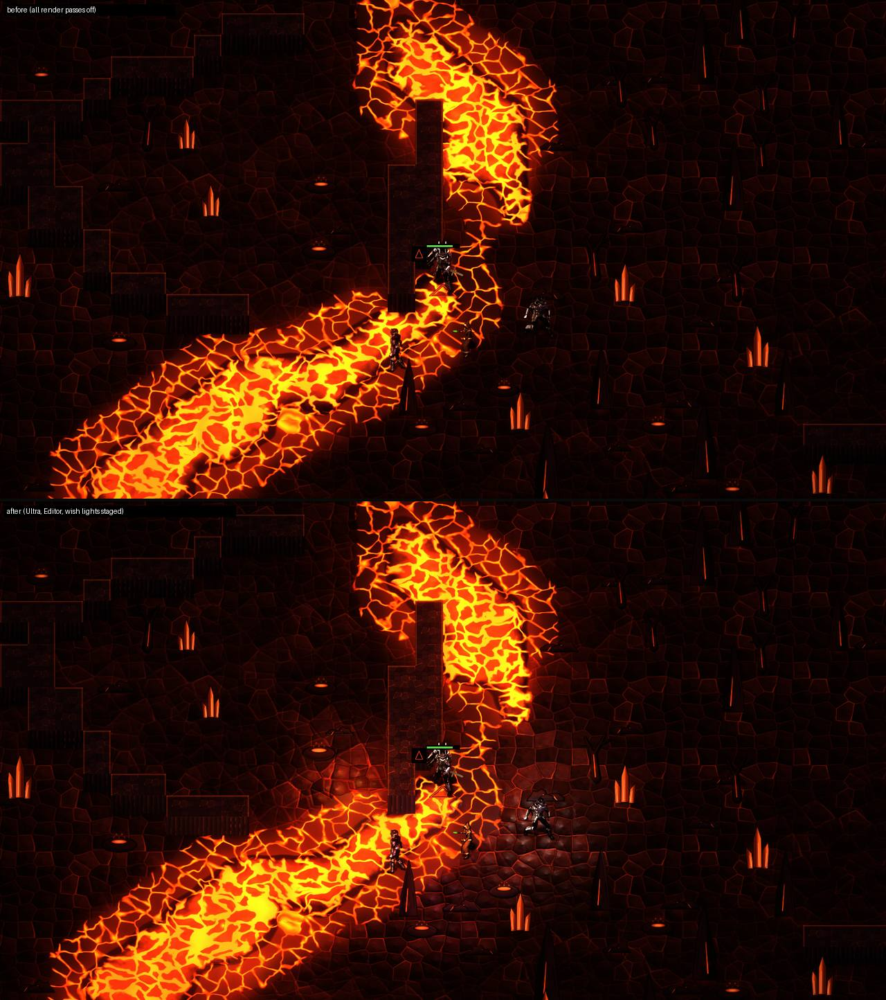 |
| Sentenced | 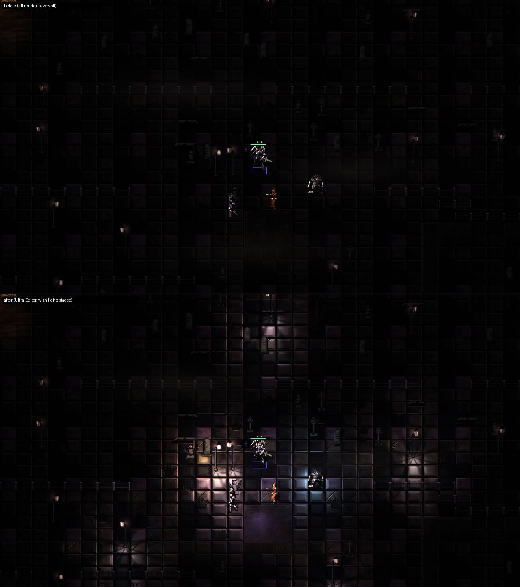 |
| Plague | 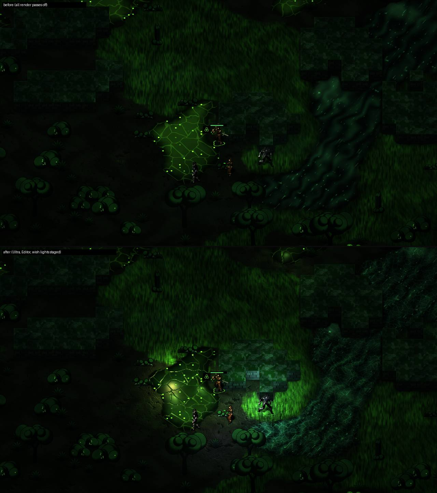 |
| Frost | 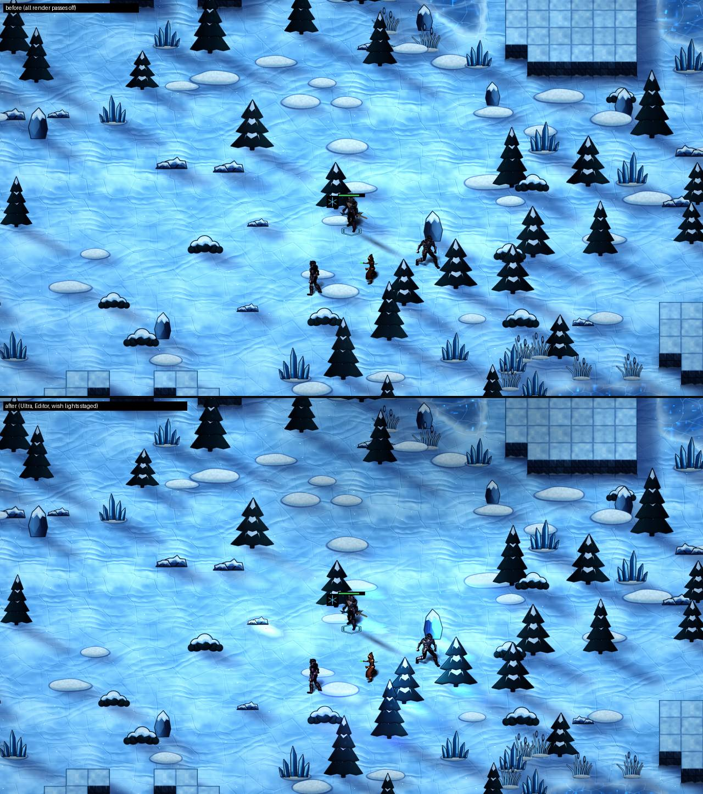 |
| Holy (temple) | 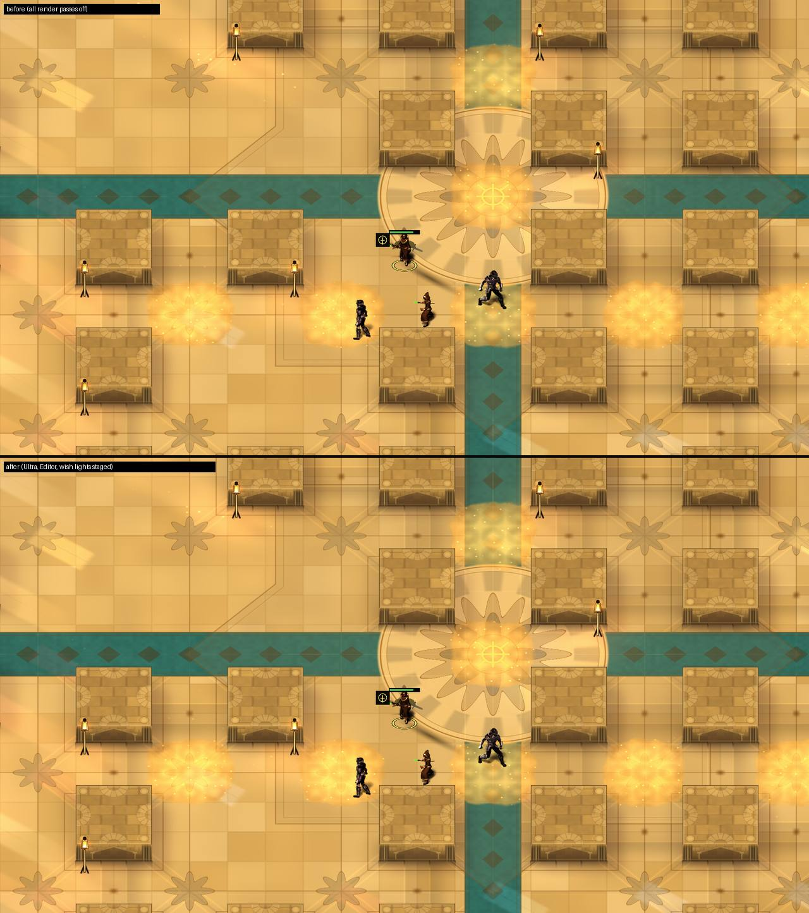 |
| Coliseum | 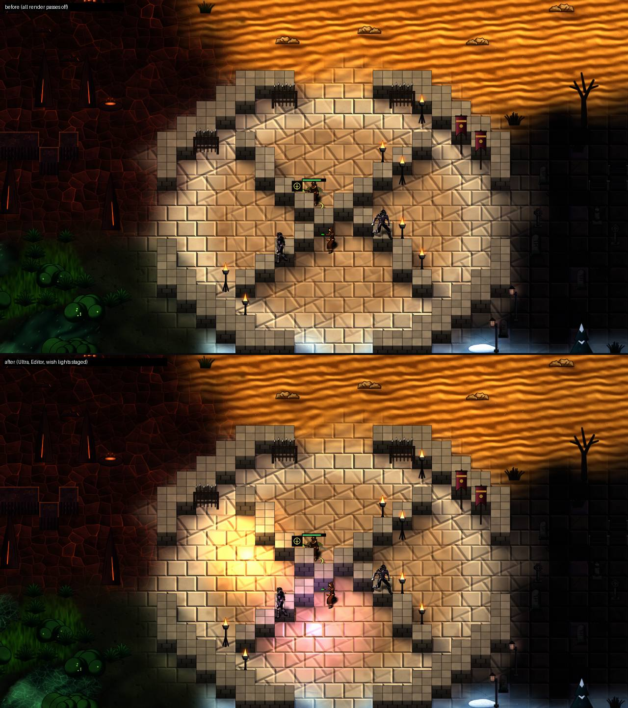 |

Browser, 1920x1080: the spawn is random, so before and after are different places in the zone (top: baseline build, Ultra; bottom: this build, Ultra or High).

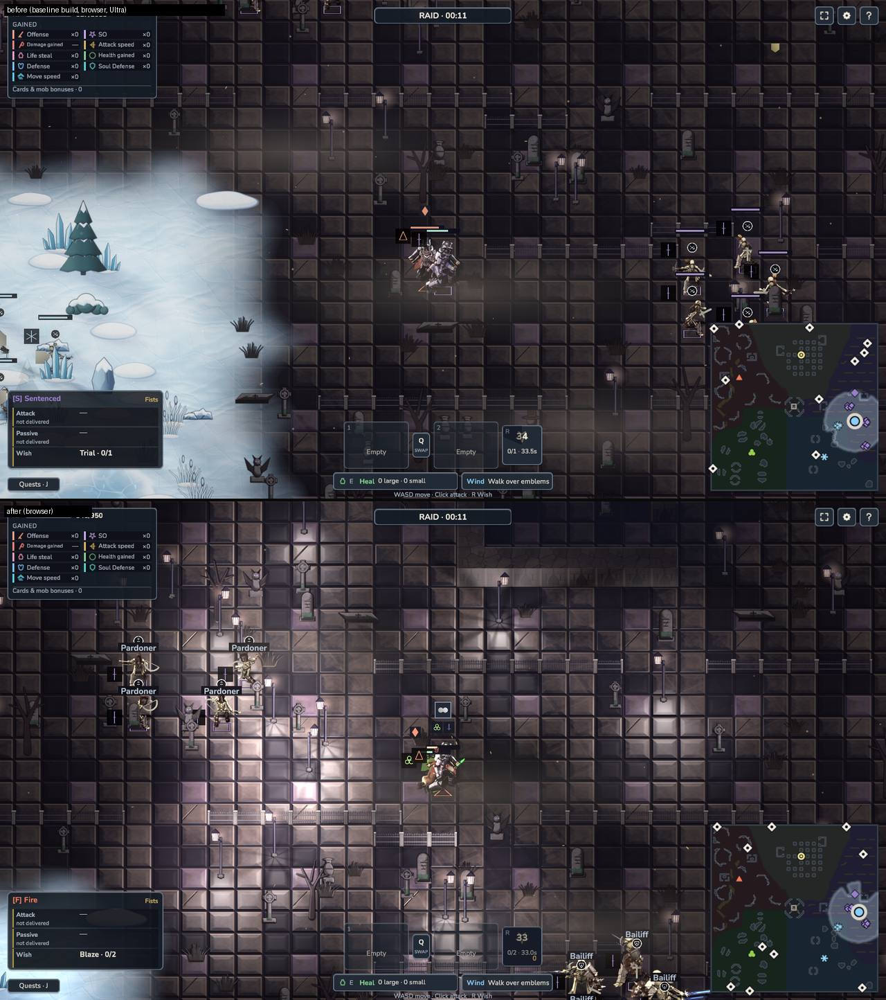

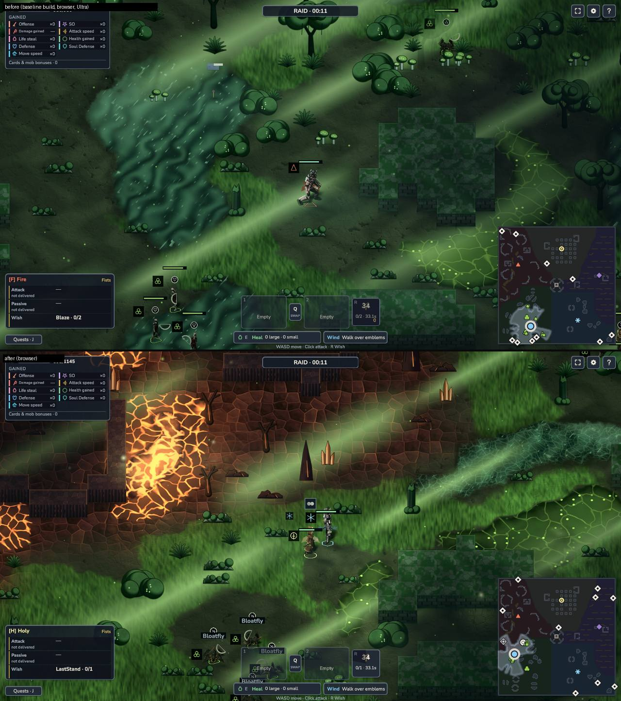

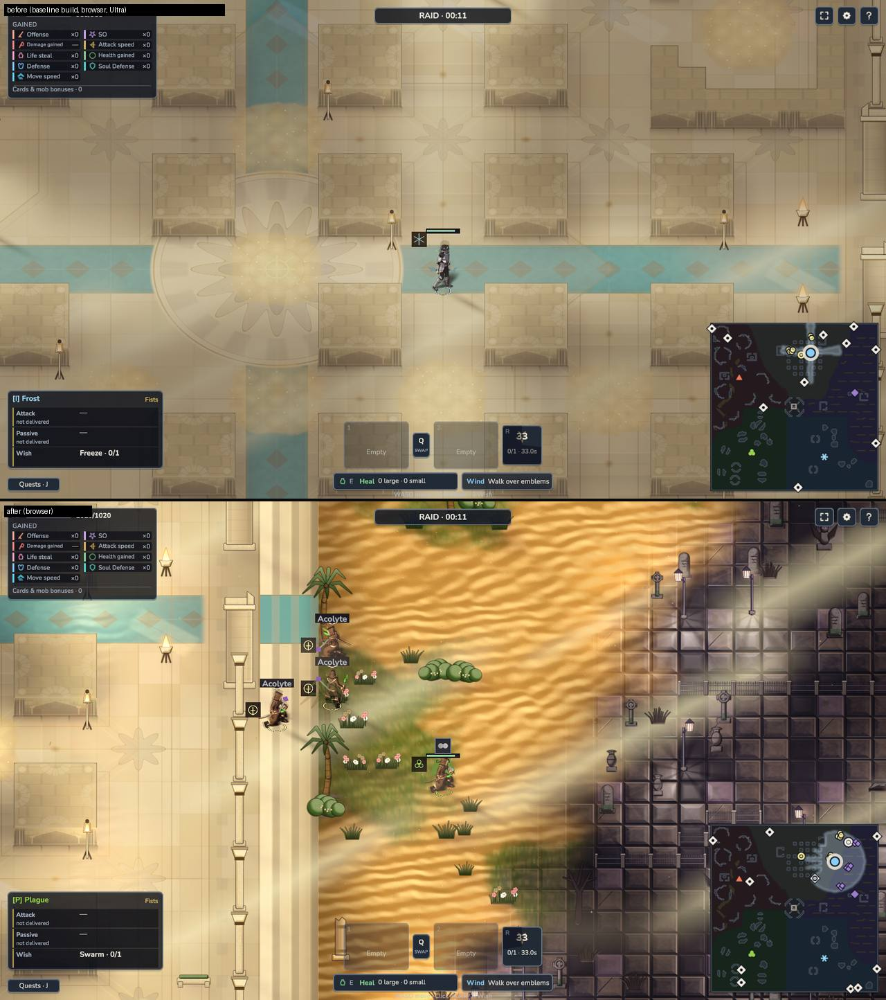

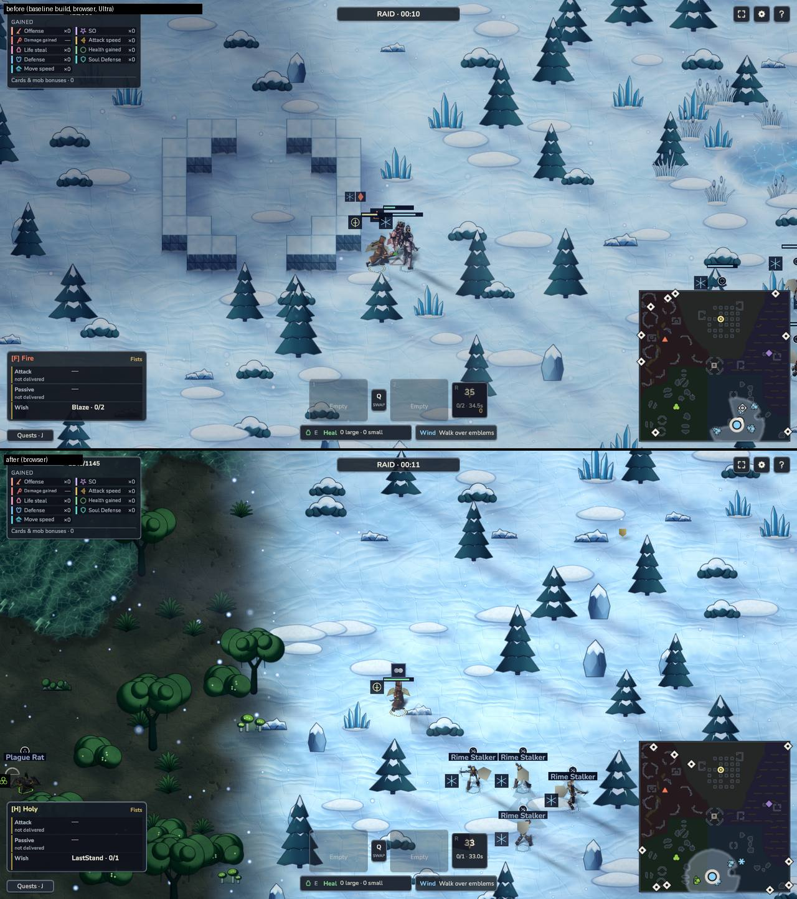

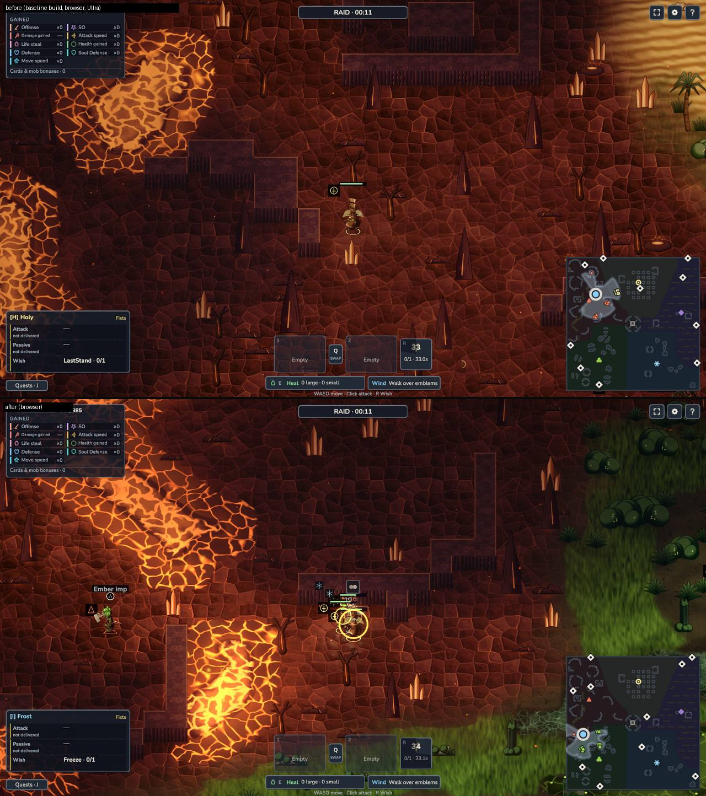

## Cost per feature, 2560x1440, vsync off (Fire, full bot match)

The machine was shared with other builds the whole time (load average 13 to 60 on 18 cores), so single-effect costs are mostly below the noise floor (0.7 ms at 1x,
1.0 ms at 2x). Two attributions, one at the real resolution and one amplified by rendering at scale 2 (four times the pixels; divide by four for the 1x cost). Medians of
3 or 4 interleaved rounds, effect off versus the adjacent baseline window:

| Effect off | 1x: ms saved (noise 0.71) | 2x: ms saved (noise 0.98) | 2x / 4 = cost at 1x |
|---|---|---|---|
| all analytic local lights (master; includes the old Light2D twins coming back) | 0.36 | **2.70** (clear of noise) | about 0.7 ms |
| local wall shadows | -0.72 | 0.51 | about 0.1 (now baked: see below) |
| characters lit by the field | | 0.41 | about 0.1 |
| relief | -0.73 | 0.08 | under 0.1 |
| gloss | -0.34 | -0.02 | under 0.1 |
| cloud shadows | -0.14 | -0.15 | under 0.1 |
| cookies | 0.05 | -0.19 | under 0.1 |
| water caustics | 0.27 | -0.43 | under 0.1 |
| trails and sparks, wind, max lights 6, painterly | within noise | within noise | under 0.3 |

Only the master switch is above the noise: the whole render pass costs about 0.7 ms at 2560x1440 in the Fire zone, and no single effect is separable from that. What was done to keep
it there: accent lights moved from per-frame Light2D (0.9 ms, measured earlier) to one array evaluated in the shaders the ground already runs (the Light2D twins stand down when characters
take the field); every light early-outs by distance and skips the faint rim; normals, cookies and shadows are evaluated only where a light reaches; wall shadows are traced once per light
on the CPU into a 5-slot atlas (one slot per frame) instead of per pixel (the per-pixel version cost about 0.8 ms in the lantern zone: 4.5 ms to 3.7 ms with shadows off); cookies and shadows
only on the nearest 6 and 5 lights; sway needs no second material (sway-capable art is packed below an atlas V threshold, so draw calls do not change); ActorField, light field,
living lights and sparks use fixed arrays (an EditMode test asserts under 4 KB of managed allocation over 200 frames).

Sentenced (the lantern zone, up to 20 lights in view) is the heaviest. In the final adjacent pair it is 3.1 ms (before) to 3.7 ms (after) at p50 and 4.7 to 5.7 ms at p95; the amplified attribution of the zone gives 2.6 ms at 2x for the master switch (about 0.65 ms at 1x) and nothing else above noise. Baked shadows removed the per-pixel trace that dominated it earlier.

## Ultra and High, 60 s runs, vsync off

Display check: `system_profiler` reports the built-in 3024x1964 panel and a 1920x1080 @ 100 Hz external, not 2560x1440 @ 144 Hz, so the 144 fps target cannot be claimed here
(`perf-run` labels every run PROVISIONAL, vsync off). The page itself renders 2560x1440. Runs are adjacent pairs (before then after), same zone, bots fighting.

| run | p50 ms | p95 ms | p99 ms | worst 1% mean ms | host load (1 min) |
|---|---|---|---|---|---|
| Fire, Ultra, before (baseline build) | 3.6 | 5.5 | 6.9 | 8.2 (122 fps) | 31 |
| Fire, Ultra, after | 3.2 | 4.8 | 7.3 | 8.7 (115 fps) | 21 |
| Fire, High, before | 3.1 | 4.7 | 6.5 | 7.6 (131 fps) | 15 |
| Fire, High, after | 3.8 | 5.6 | 7.7 | 8.9 (112 fps) | 17 |
| Sentenced, Ultra, before | 3.1 | 4.7 | 5.8 | 7.2 (140 fps) | 39 |
| Sentenced, Ultra, after | 3.7 | 5.7 | 7.8 | 9.3 (107 fps) | 38 |

Read it as: at vsync off, p50 is 2.6 to 5.6 ms depending on machine load (the "before" column moves as much as the "after" column between pairs); the render pass costs about 0.7 to
1.4 ms at Ultra in these zones; p95 stays under 6.94 ms only when the machine is quiet. The worst-1% criterion (at or above 120 fps) is missed by both the before and the after build
under this load; the coordinator should repeat the Ultra runs on the quiet owner machine.

## Brightness: mean luma, p95 and clipped fraction (>0.9) per zone, real browser, with the HUD in frame

Median over the sessions that landed in the zone (spawn is random, so the spots differ between builds; n is the number of screenshots). Last column: lowest character sprite contrast
(`atmosphere-shots` ring metric).

Before (baseline build, Ultra):

| zone | n | mean | p95 | clipped % median / max | min sprite contrast |
|---|---|---|---|---|---|
| fire | 2 | 0.155 | 0.418 | 0.04 / 0.04 | 4.1 |
| sentenced | 2 | 0.242 | 0.816 | 0.04 / 0.04 | 6.2 |
| plague | 2 | 0.212 | 0.436 | 0.04 / 0.04 | 4.0 |
| frost | 8 | 0.547 | 0.775 | 0.04 / 0.04 | 6.1 |
| holy | 6 | 0.516 | 0.732 | 0.04 / 0.05 | 5.7 |

After (Ultra):

| zone | n | mean | p95 | clipped % median / max | min sprite contrast |
|---|---|---|---|---|---|
| fire | 2 | 0.184 | 0.603 | 0.63 / 0.65 | 8.7 |
| sentenced | 4 | 0.258 | 0.696 | 4.29 / 8.42 | 7.7 |
| plague | 8 | 0.238 | 0.528 | 0.11 / 0.25 | 3.4 |
| frost | 4 | 0.629 | 0.901 | 5.95 / 8.55 | 8.4 |
| holy | 2 | 0.522 | 0.853 | 1.15 / 1.22 | 5.8 |

After (High):

| zone | n | mean | p95 | clipped % median / max | min sprite contrast |
|---|---|---|---|---|---|
| fire | 2 | 0.178 | 0.445 | 0.26 / 0.27 | 12.7 |
| sentenced | 2 | 0.207 | 0.546 | 0.73 / 0.95 | 1.5 |
| plague | 0 | - | - | - | - |
| frost | 4 | 0.548 | 0.897 | 4.42 / 5.11 | 11.6 |
| holy | 2 | 0.510 | 0.851 | 1.06 / 1.09 | 5.9 |

Editor, same spot, all passes off versus on (no HUD): fire 0.089 to 0.101 mean (clip 0.66% to 0.71%), sentenced 0.017 to 0.039, plague 0.049 to 0.065, frost 0.606 to 0.592
(1.40% to 1.69%), holy 0.625 to 0.625 (0.08% to 0.14%), coliseum 0.277 to 0.278 (0.44% to 1.52%, a staged flash). A dash means no session landed in that zone.

Two things were measured and corrected on the way: the painterly lift/gain raised mean luma by about 30% in Fire and cost hp-bar and marker contrast, so it ships off (`?fx.painterly=1`
opts in); a Neutral tonemap compressed the highlights back but lowered marker and body contrast in the bright zones, so it is a separate switch (`?fx.tonemap=1`), off. Lights add through
the surface's headroom (`RhHeadroom`), which took the temple's clipped fraction from 11.4% to 0.6%. The light-ordering and passive-floor tests are unchanged and pass.

## Contrast (the hard gate)

`contrast-gate.cjs` (`?contrastlab=1`), 1920x1080, Ultra and High, one page per zone (26 cells each), "on" is this build, "off" is the same build with every render pass off. The gate's strict
statistic (outer 2 px of the silhouette, p10 of 16 sectors) is 0/312 in both, as it is on the base art; the coordinator's contrast branch owns that fix. What this branch must show is that it
does not move it: no cell changed pass or fail (edge p10 mean absolute change 0.06, max 0.86 over 312 cells, `--compare`), and the marker counts are the same as with everything off.

| quality | zone | EDGE p10 >= 3 (strict) | markers >= 4.5, passes on | markers >= 4.5, all passes off | body median, on | body median, off |
|---|---|---|---|---|---|---|
| high | fire | 0/26 | 0/26 | 0/26 | 1.36 | 1.36 |
| high | sentenced | 0/26 | 0/26 | 0/26 | 1.83 | 1.84 |
| high | plague | 0/26 | 0/26 | 0/26 | 1.21 | 1.21 |
| high | frost | 0/26 | 13/26 | 13/26 | 7.47 | 8.09 |
| high | holy | 0/26 | 7/26 | 7/26 | 4.01 | 4.00 |
| high | coliseum | 0/26 | 13/26 | 13/26 | 5.96 | 6.21 |
| ultra | fire | 0/26 | 0/26 | 0/26 | 1.36 | 1.36 |
| ultra | sentenced | 0/26 | 0/26 | 0/26 | 1.83 | 1.86 |
| ultra | plague | 0/26 | 0/26 | 0/26 | 1.21 | 1.20 |
| ultra | frost | 0/26 | 13/26 | 13/26 | 7.67 | 7.97 |
| ultra | holy | 0/26 | 7/26 | 7/26 | 4.03 | 4.01 |
| ultra | coliseum | 0/26 | 13/26 | 13/26 | 6.12 | 6.15 |

Character shading (`RegionActorLit.shader`) touches only pixels at least 3 px inside the silhouette (never the outer 2 to 3 px, per the coordination note), so it cannot change an edge. The hp
bar, faction mark and insignia are not touched by this branch. Cloud shadows, grass parting, fireflies and reflections are cleared around presented actors (`RhActorClear`, 2 tiles).
The atmosphere-shots "bar" ring metric stopped being comparable after the merge (the new overhead indicator plate sits in its window), so the gate's marker numbers are the ones to read.

## Honest weak spots

* Fire and Sentenced are the darkest zones and the lights make them read well, but Sentenced's lantern grid plus flagstone bevels can look busy where several lights overlap.
* No actor reflection on ice or water, no heat distortion of actors, no birds: documented above.
* Plague water caustics and ripple bending are visible but subtle; the bog glows through the existing emission and the local lights, not through new surface art.
* Per-effect cost is below the noise of this shared machine; only the aggregate is resolved.
* Frost snow is bright already; local lights there are headroom-limited, so the glints are small by design.

## Notes for the coordinator

* **Frost brightness.** With every render pass switched off, this merged build already clips 7.6% of a Frost frame at the same spot (0.04% on the base commit's build), mean luma 0.63 versus 0.55.
  The passes add 1.7 points of clipping (lights on ice and snow, headroom-limited) on top. The cause of the 7.6% is not in this branch's switches (it appears with all of them off), so
  it comes from something merged from `feature/unity-rework` or from a base-versus-spot difference; a baseline build of the merged tree without this branch would separate the two. Holy, Plague, Sentenced, Fire stay at or under about 1.2% (lava cores aside).
* **Region labels** in the luma tables come from the last `[atmosphere] region` log line and can lag at a border: one frame labelled sentenced (clip 8.4%) is a Frost-border frame.
* **Character rim-light** (`RegionActorLit.shader`, the Body renderer's material, set in one line in `SpriteActorPresenter.Create`): diffuse and a rim from a pseudo normal of the sprite itself, applied only to pixels at
  least 3 px inside the silhouette (interior mask, 5 taps), additive, never darkening, no outline, no faction colour. It takes the actor sprite shader slot the contrast branch also wants:
  keep the interior mask or fold the light term into the replacement shader. With `?fx.actorlights=0` it is the stock lit sprite again.
* **Shared grab:** none used. `m_UseCameraSortingLayersTexture` is untouched (0). Water refraction, caustics, ice depth and lava shimmer are computed inside the ground shader.
* **SurfaceFx ripples:** wade ripples (Shallow only, up to 6, `SurfaceFx.CopyRipples`) bend the Plague water surface through the new `_RhRip` globals; only actors the client presents make ripples.
* **Hook lines** added to `ArenaView.cs` (marked "render pass"): field `CombatSparks _sparks ...`; `_sparks = new CombatSparks(...)` in Awake; `ActorField.Begin()` after `_actors.Begin()`; three `ActorField.Note(...)` beside the
  three `_regionProps.NoteActor` calls; `ProjectileFx` helper plus its call and `_sparks.Observe(...)` in the projectile loop; `_sparks.Hit(...)` in `PresentFx`; camera centre and half size stored in `Follow`; `_sparks.Clear()` in
  `ResetTransientPresentation`. `SpriteActorPresenter.cs`: one line after `a.Body = ...` (`a.Body.sharedMaterial = ShowcaseSprites.ActorLit;`). `PerfRecorder.SetFlags` also feeds the new switches.
* **Held off by default, built, switchable:** `fx.painterly=1` (lift/gain tints) and `fx.tonemap=1` (see above). Both need a re-tune before they can ship; the zone grade rows are in `RegionAtmosphereTable`.
